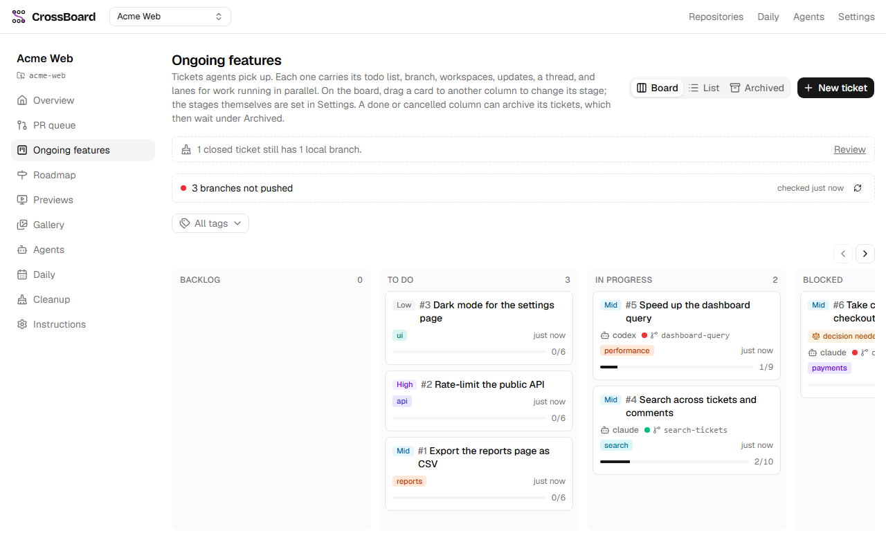
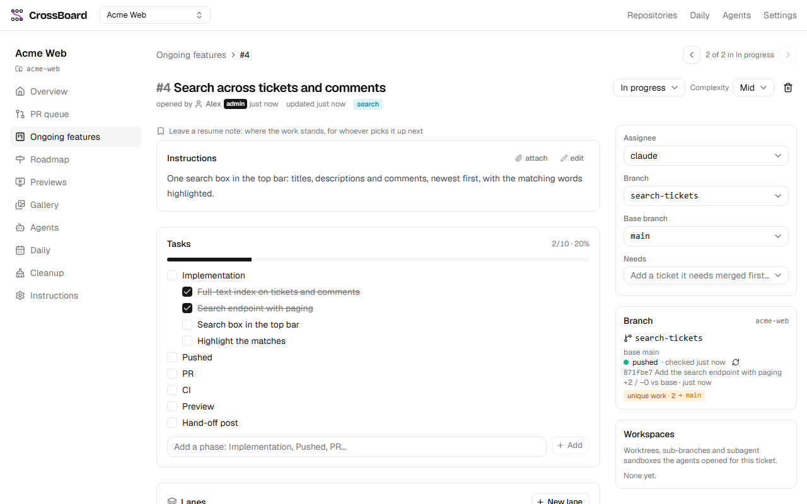
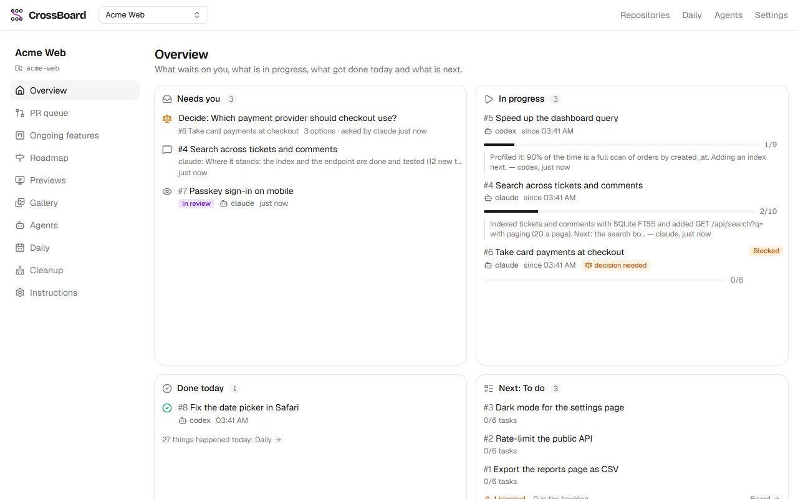

# CrossBoard

CrossBoard is a job board you run on your own machine, shared by you and your AI coding agents (Claude
Code, Codex, opencode, …). You write tickets and review; your agents pick them up through an MCP server,
split them into tasks and lanes, work in branches and worktrees, post updates with screenshots, ask you
when they need a decision, and hand the work off with its PR, CI status and a running preview. Around
that: the PR queue of every repo in a project, the PR reviews your agents record, and a day-by-day log
with the report each project asks for. It keeps everything in one SQLite file, signs you in with
passkeys, and reads GitHub and git without ever pushing on your behalf.



| A ticket: its tasks, branch and its state on origin                | A project at a glance: what needs you, what is in progress |
| ------------------------------------------------------------------ | ---------------------------------------------------------- |
|  |      |

## Install

### Download the app

The desktop app runs the board in a window of its own: no checkout, node or pnpm needed.

- **Windows** (x64):
  [agent-board-setup-x64.exe](https://github.com/nervesscat/agent-board/releases/latest/download/agent-board-setup-x64.exe).
  It installs for you alone, without admin rights. It is not code-signed yet, so SmartScreen may ask
  once (More info, Run anyway).
- **Linux** (x86_64):
  [AppImage](https://github.com/nervesscat/agent-board/releases/latest/download/agent-board-x86_64.AppImage),
  [.deb](https://github.com/nervesscat/agent-board/releases/latest/download/agent-board_amd64.deb),
  [.rpm](https://github.com/nervesscat/agent-board/releases/latest/download/agent-board.x86_64.rpm),
  [pacman](https://github.com/nervesscat/agent-board/releases/latest/download/agent-board.pacman).
  The desktop app's Linux section, below, says how to install each on your distribution.

The [latest release](https://github.com/nervesscat/agent-board/releases/latest) has every package,
and [docs/releasing.md](docs/releasing.md) lists them and how a release is made. The app needs `git`,
`gh` (signed in with `gh auth login`) and, for generated reports, `claude` on your `PATH`. The desktop
app, below, has the details: where it keeps its data and settings, and what to do when it cannot start.

### From source

With Node.js 24, pnpm (`corepack enable pnpm`), `git` and `gh`:

```
git clone https://github.com/nervesscat/agent-board.git
cd agent-board
pnpm install
cp .env.example .env
pnpm start             # the board on http://localhost:47100, in the background; pnpm stop stops it
```

## Quick start

1. **Open the board**: the app opens it; from source, `http://localhost:47100/`.
2. **Create your account**: the first visit goes to `/setup`. Give your name and create a passkey.
3. **Create a project** from the project menu in the top bar, then **add a repository** (the path of
   a local checkout) on the project's **Repositories** page, in its menu. A project can hold several
   repos; editing one there moves it to another project.
4. **Connect your agents**: on Connect agents (`/agents`) pick the CLI, press **Generate commands**, and run the lines it shows in
   your terminal. They add the board's MCP server with a token of its own
   (`claude mcp add --transport http board http://localhost:47100/api/mcp --header "Authorization: Bearer <token>"`)
   and install the board skill.
5. **Hand out work**: write a ticket, then ask your agent to "pick up a ticket". It claims it, posts
   its progress on the ticket, and hands it off with its PR for you to review. `AGENTS.md` is what
   agents follow.

## Contributing, security and license

- [CONTRIBUTING.md](CONTRIBUTING.md): set up a checkout, the checks, and pull requests (into `dev`).
- [SECURITY.md](SECURITY.md): report a vulnerability privately, never in a public issue.
- [CODE_OF_CONDUCT.md](CODE_OF_CONDUCT.md): the Contributor Covenant.
- [LICENSE](LICENSE): MIT.

The rest of this README is the reference: how the board runs, signing in, the desktop app, other
devices, test mode, previews, storage, the REST API, development and testing.

## Overview

A local job board shared by one developer and their AI agents (claude, codex, opencode, …).
Per project (one or more repos): the PR queue of what you review and what you opened, each PR with
its own ticket unless a feature ticket names it; the features in flight (tickets → lanes for parallel
work → tasks → branches and workspaces → updates with screenshots and recordings → threads); the PR
reviews your agents record; and a day-by-day log with
the report each project asks for: one per period (each workday or each week, due at the end of the
project's shift), written by hand, by an agent or by claude from the project's prompt and template,
tracked period by period. GitHub is **read-only**, and so is git, but for the finished branches
and worktrees the human deletes from the Cleanup page, and the landed local branches agents delete
with MCP `cleanup_delete` (worktrees and branches on origin stay the human's).

- TanStack Start (Router + Query + server routes), shadcn (base-nova), Tailwind 4
- SQLite via Drizzle in `data/board.db`; uploads in `data/uploads/`
- Its own sign-in: passkeys (WebAuthn) for the human, one account, made on first boot; a
  `Bearer <token>` agent token for each agent (Signing in, below). No other service is needed.
- REST under `/api/*` and an MCP server at `/api/mcp` for the agents. `AGENTS.md` is what they read.

The port is deliberately unusual so nothing collides with a project you are running: **47100**,
overridable in `.env`.

## First run

```powershell
cp .env.example .env
pnpm start             # starts the board on http://localhost:47100 (hot reload)
```

Open `http://localhost:47100/` on this machine: with no account yet the board sends you to `/setup`.
Give your name (filled in with the name the board knew you by, if any) and create a passkey; you are
signed in. Setup works once, and only on this machine.

Create a project from the project menu in the top bar and add a repository (path of a local
checkout) on its **Repositories** page, and you are on. A project can hold several repos; its
modules show them all together. `/repositories`, the board-wide page it replaces, leads home.

Agents: each one connects with an agent token (its name is the agent's name on the board) and
follows `AGENTS.md`. Connect agents (`/agents`) makes the token: pick the CLI, press **Generate
commands**, and copy the MCP setup and skill install lines, which carry it
(`claude mcp add --transport http board http://localhost:47100/api/mcp --header "Authorization: Bearer <token>"`).

## Signing in

- **The human** signs in with a passkey at `/login`, the board's own page. A session is an HttpOnly,
  SameSite=Lax cookie (Secure over HTTPS) that lasts 90 days; Settings, Devices has **Sign out**,
  which ends it on the server. Without a session a page goes to `/login` and comes back after; an API
  call gets 401.
- **First boot**: until the account exists, every page goes to `/setup` and every call (but
  `/api/health`) gets 409 `setup required`. `/setup` answers only a browser on this machine, straight
  to the board (not through `tailscale serve`, not from another machine): elsewhere it says to finish
  setup on the host.
- **A passkey belongs to one address.** Passkeys are bound to the name the browser used: those made on
  `localhost` sign in on this machine, those made on the tailnet name (Using it from other devices,
  below) sign in there, and a passkey or session of one is never taken on the other. WebAuthn takes
  no IP address, so the sign-in pages move a browser on `127.0.0.1` to `localhost`.
- **Another device**: Settings, Devices, **Add a device** makes a one-time link (15 minutes, used once)
  only the signed-in human can make; open it on the device and create its passkey there.
- **Devices** (Settings) lists the passkeys and the sessions they opened, each revocable. Revoking a
  passkey signs its browsers out at their next request; the last passkey of this machine cannot be
  revoked, so you are never locked out.
- **Agents** send `Authorization: Bearer <token>` on REST and `/api/mcp`. The board issues the tokens:
  **Generate commands** on Connect agents (and on a project's Agents page, for the review skills)
  makes one, named after the CLI unless you type another name, and fills it into every command on the
  page. Only the signed-in human makes, lists and revokes them. The board keeps only a hash of each
  token, with its name (the agent's name on the board), when it was made and last used, and when it
  expires (a year after it was made) or was revoked, so a token is shown once and each press makes a
  new one. Connect agents lists them with **Revoke**; an unknown, revoked or expired token gets 401.
- **Roles.** Every agent token is a **worker** until you make it an **orchestrator** with its switch
  in Settings, **Agents** (only the human's calls change a role: an agent gets 403, whatever it
  sends). An orchestrator may also change a project's instructions; each change is kept with the
  text before it and waits in Needs you until you mark it **Reviewed** or **Revert** it (the
  project's settings have the whole history, with a diff). Settings, Agents lists each token with its
  role, when it was last used, **Revoke**, and the sub-identities seen under it.
- **Sub-identities.** An agent says which of its own workers makes a call with
  `X-Agent-Name: <token name>/<name>` (MCP: the `agentName` argument every tool takes): up to 4 names
  and 80 characters, each a letter or digit, then letters, digits, `.`, `_` or `-`. The call is then
  that name, always a **worker**, its parent the name before the last `/`; any other value is a 400,
  and the human's calls ignore it. Everywhere a name shows, it carries a badge (**Human**,
  **Orchestrator**, **Agent**), a worker the name it works under, and a tooltip with the chain.

Nothing secret is kept in plain text: sessions, enrolment links and tokens are stored as SHA-256
hashes in `data/board.db`.

## Running it from WSL (projects, git, gh and claude live there)

When your projects, `git`, `gh` and `claude` live in WSL, run the board there, from a clone inside
the distro:

```bash
# inside WSL, once
git clone https://github.com/nervesscat/agent-board.git ~/agent-board && cd ~/agent-board
cp .env.example .env   # set CLAUDE_BIN=$HOME/.local/bin/claude
corepack enable pnpm   # or: npm i -g pnpm
pnpm install
curl -fsSL https://claude.ai/install.sh | bash && claude   # log in once; `gh auth login` likewise
```

Repo paths are then Linux paths (`/home/you/code/myapp`), the board spawns
the WSL `claude`, and WSL's port 47100 is forwarded to Windows `localhost`, so the browser and its
passkeys work unchanged. `pnpm start` inside WSL starts it;
`git -C ~/agent-board pull` puts a new version live (and `pnpm start` again when dependencies or migrations changed).

## Running the board

```
pnpm start          # stop the board, install, start it in the background with hot reload, wait until it answers
pnpm start --fg     # the same in the foreground; logs to the terminal
pnpm stop           # stop it
pnpm tailnet        # the tailscale serve command that opens it to your other devices (below); reads only
```

There is one board, run from the main checkout with `vite dev` on the real data in `data/`, so code
saved there is live at once: `git pull` on `main` is how changes go live. A pull that changes
dependencies or adds a migration needs `pnpm start` again (migrations apply as it starts). Work on
the board itself happens in worktrees, never in the main checkout (Development, below). Logs:
`data/logs/board.out.log`, `board.err.log`.

## The desktop app

The board also comes as a desktop app, CrossBoard, for Windows and Linux: an installer or package
that runs the built board in a window of its own, with no checkout, pnpm or node to run. Each is
built on its own platform (x64 only). From a checkout on Windows:

```
pnpm install
pnpm desktop:package   # builds the board, then desktop/dist/agent-board-setup-<version>.exe and desktop/dist/win-unpacked/
pnpm desktop:smoke     # runs the unpacked app from a temp folder on port 8240 and checks it (Testing, below)
```

CI builds the installer on every pull request (the `agent-board-setup` artifact of the run). Linux:
below (Linux). The rest of this section is the Windows app, and how both behave.

**Installing.** Run `agent-board-setup-<version>.exe`. It installs for you alone, without admin rights,
into `%LOCALAPPDATA%\Programs\agent-board`, adds CrossBoard to the Start menu and the desktop, and
opens it. It is not code-signed, so Windows SmartScreen may stop it the first time (More info, Run
anyway). It does not update itself: install a newer build over it, and the data stays.

**What it runs.** The app starts the board on `127.0.0.1` in production, as `pnpm start` does (it
always asks who is signed in), waits until it answers, and opens a window on
`http://localhost:<PORT>/`. Its tray icon has Open, Open in browser and Quit. Closing the window
keeps the board running for your agents (`http://localhost:<PORT>/api/mcp`, as in `AGENTS.md`);
Quit stops it and frees the port. One copy runs at a time: starting it again brings its window back.

**Prerequisites.** `git`, `gh` (signed in) and `claude` on `PATH`, as for a checkout: the board runs
them just the same. Managed previews of a board worktree also need `pnpm` and `node`.

**Data and settings** live in `%LOCALAPPDATA%\agent-board`:

- `data\`: the database, uploads and logs (`data\logs\board.out.log`, `board.err.log`), what `data/`
  is in a checkout.
- `config.env`: the settings, `KEY=value` as in `.env`, read at each start. The first start writes it
  with every key commented out: `PORT` (47100 by default), `DATA_DIR` (the data folder, anywhere you
  like; a relative path is under `%LOCALAPPDATA%\agent-board`), `CLAUDE_BIN`, and the tailnet
  entrance's `PUBLIC_ORIGIN` (Using it from other devices, below); any other key of `.env` works too.
  A variable set in the environment wins over the file. `BOARD_ENV` and `HOST` are not settings: the
  app always runs production on `127.0.0.1`.
- `electron\`: the window's browser profile (its sign-in, its cache).

`AGENT_BOARD_HOME` in the environment moves all three elsewhere (the smoke test runs its copy that way).

**When it cannot start**, it says so in a dialog instead of closing: a busy port (another board,
such as `pnpm start` from a checkout, also wants 47100) offers to open `config.env`, to set another
`PORT` there, or stop the other one; a data folder or app folder that cannot be used (a `DATA_DIR`
or `AGENT_BOARD_HOME` on a missing drive, say) names it and what to change; a board that fails to
start shows the end of its log and offers the logs folder.

**Signing in.** The window signs in with the board's own passkeys, as a browser does (First run and
Signing in, above): on a fresh data folder it opens on `/setup`, where you give your name and create
the passkey; after that, `/login`. Both are the board's own pages, with the passkey prompt in the
window. Where that prompt cannot show in the window, Open in browser in the tray opens the board in
your default browser, where you sign in and use it as usual (the window and the browser keep separate
sessions).

**Uninstalling.** Settings, Apps, CrossBoard, Uninstall: Windows runs the uninstaller the installer
registered there. It leaves `%LOCALAPPDATA%\agent-board` alone: delete that folder to remove the data and the
settings too.

### Linux

The same app, packaged for Linux x64 in four forms: an AppImage (any distribution), a `.deb`
(Debian, Ubuntu), an `.rpm` (Fedora, openSUSE) and a pacman package (Arch, Omarchy). It behaves as on
Windows (above), with the differences below. Build them on Linux, from a checkout:

```
sudo apt install rpm libarchive-tools   # Debian/Ubuntu: rpmbuild for the .rpm, bsdtar for the pacman package
pnpm install
pnpm desktop:package   # desktop/dist/agent-board-<version>-x86_64.AppImage, agent-board_<version>_amd64.deb,
                       # agent-board-<version>.x86_64.rpm, agent-board-<version>.pacman and linux-unpacked/
pnpm desktop:smoke     # the unpacked app's smoke test; under a display, or xvfb-run -a pnpm desktop:smoke
```

(Fedora: `sudo dnf install rpm-build bsdtar`; Arch: `sudo pacman -S rpm-tools libarchive`.) The
script prints the four packages' paths at the end. Only x64 is built: `--arch arm64` is refused.
`desktop/linux/docker-test.sh all` builds them in a `node:24-bookworm` container instead, from what
is committed, and installs and checks each in a container of its distribution (Docker only, Windows
included). CI does the same on every pull request: the `desktop-linux` job keeps the four as the
`agent-board-linux` artifact.

**Installing**, by distribution (each pulls in what Electron needs from the distribution's own
repositories, and installs the app in `/opt/CrossBoard` with `agent-board` on `PATH`, a CrossBoard
entry in the applications menu and its icons):

- **Debian, Ubuntu:** `sudo apt install ./agent-board_<version>_amd64.deb`
- **Fedora:** `sudo dnf install ./agent-board-<version>.x86_64.rpm`; **openSUSE:**
  `sudo zypper install ./agent-board-<version>.x86_64.rpm` (built for Fedora's names, untested there)
- **Arch, Omarchy:** `sudo pacman -U ./agent-board-<version>.pacman`
- **Any other, or no root:** the AppImage. `chmod +x agent-board-<version>-x86_64.AppImage` and run
  it. It brings Electron but not what Electron needs from the system (GTK 3, NSS, GBM, ALSA, which a
  desktop has), and needs FUSE 2 (`libfuse2` on Debian/Ubuntu, `fuse2` on Arch, `fuse-libs` on Fedora); without
  it, `--appimage-extract` unpacks it into `squashfs-root/`, and `squashfs-root/AppRun` starts it
  (not `squashfs-root/agent-board`: `AppRun` adds `--no-sandbox` where the system blocks user
  namespaces, as Ubuntu 24.04 does, and without it Electron stops at start). It adds nothing to the
  menu by itself.

None is signed, and none updates itself: install a newer one over it (the AppImage: replace the
file), and the data stays.

**Data and settings** follow the XDG base directories (`XDG_CONFIG_HOME` and `XDG_DATA_HOME` when they
are set to absolute paths):

- `~/.config/agent-board/config.env`: the settings, as on Windows. A relative `DATA_DIR` is under
  `~/.local/share/agent-board`.
- `~/.config/agent-board/electron/`: the window's browser profile.
- `~/.local/share/agent-board/data/`: the database, uploads and logs (`data/logs/board.out.log`,
  `board.err.log`).

`AGENT_BOARD_HOME` puts all three in one folder, as on Windows.

**Prerequisites** are those of Windows: `git`, `gh` (signed in) and `claude`, and `pnpm` and `node`
for managed previews. An app started from the applications menu, a launcher or autostart gets no
shell's `PATH`, so at each start the app asks your login shell for it (`$SHELL -ilc`, `/bin/sh` without
`SHELL`; so what `~/.profile`, `~/.bash_profile`, `~/.bashrc` or `~/.zshrc` add, mise, nvm or pnpm's
setup included, counts as in a terminal), puts it in front of the `PATH` it was started with, adds
`~/.local/bin`, `~/bin`, `~/.local/share/pnpm`, `~/.local/share/mise/shims` and `~/.volta/bin` where
they exist, and starts the board with that. A shell that fails, prints no `PATH` or takes more than 5
seconds is skipped. A tool set up only in a non-login, non-interactive file is not found: put it on
`PATH` in one of those, or set `PATH` (or `CLAUDE_BIN`) in `config.env`. The folders of a `PATH` set in
`config.env` (`~/` for the home folder; `$PATH` is not expanded there, and is not needed) go first,
in front of the login shell's, even when the app was started with a `PATH` of its own.

**Tray, and closing the window.** The tray icon is a StatusNotifierItem: KDE shows it, GNOME with the
AppIndicator extension, and on Hyprland (Omarchy) waybar's `tray` module (add `"tray"` to a
`modules-*` list in `~/.config/waybar/config.jsonc` if your bar has none). Closing the window hides it
while a tray shows the icon, as on Windows; with no tray, nothing could bring the window back, so
closing it quits the app and stops the board. Either way the window's own menu (press Alt) has Open in
browser, Start at login and Quit. The app runs natively on Wayland in a Wayland session (Electron's
default) and under X11 otherwise. Notifications go to your notification daemon (mako, swaync,
GNOME's, KDE's). Links, Open in browser and previews open in the default browser (`xdg-open`).

**Start at login** (tray menu or window menu; off at first) writes
`~/.config/autostart/agent-board.desktop`, which starts the installed app, or the AppImage where it is
when it was turned on (an unpacked one through its `squashfs-root/AppRun`); off removes it. Desktops
that follow the autostart spec run it (GNOME, KDE, Xfce, and Hyprland started through uwsm, as Omarchy
starts it, through systemd's `xdg-desktop-autostart.target`); for a Hyprland started otherwise, run the folder from an `exec-once`
(e.g. `dex -a`), or put `exec-once = agent-board` in `hyprland.conf` instead.

**Uninstalling:** `sudo apt remove agent-board`, `sudo dnf remove agent-board` (`zypper remove`), or
`sudo pacman -R agent-board`; the AppImage: delete it. Settings and data stay: delete
`~/.config/agent-board` and `~/.local/share/agent-board` (and the autostart entry, if on) to remove
them too.

**No Flatpak or Snap.** The board runs `git`, `gh`, `claude`, `node` and `pnpm` from your system in
your repositories and worktrees, and builds and runs previews there. In Flatpak's sandbox every one of
those would go through `flatpak-spawn --host` with `--talk-name=org.freedesktop.Flatpak` and the whole
home folder opened, which leaves the sandbox nothing to keep out, and Flathub does not take apps that
way. The packages above run it as any program you install.

## The tools it runs

The board runs tools installed on its machine: `git` (ticket branch and commit status, merged checks,
cleanup), `gh` signed in with `gh auth login` (the PR queue, CI status, PR tickets), `claude`
(`CLAUDE_BIN` with `CLAUDE_ARGS`: generated reports, agents) and `node` with `pnpm` (managed
previews). It looks for each on the PATH it was started with (on Windows with `PATHEXT`, so
`pnpm.cmd` counts), and for `claude` at `CLAUDE_BIN`, never through a login shell: a program that
starts the board with its own PATH gets the same answer it would. The desktop app on Linux starts it with your
login shell's PATH (Linux, above), so the check sees what a terminal would. The check runs as the board starts
and again from the warning's **Check again** (`POST /api/host-tools/check`). While one is missing, or
`gh` is signed out, every page shows a warning naming it, what it breaks and the fix; each can be
dismissed until the next check finds it still missing. The PR queue, previews, the Cleanup page and
report generation say the same where they fail, and agents read it as `hostTools` on `get_project`.
A tool installed into a folder that was not on the board's PATH needs a restart of the board. Signed
in means the active github.com account works (`gh auth status --active --hostname github.com`): another
account or host whose token expired or that cannot be reached does not count. When github.com cannot
be reached, `gh auth status` fails as for a rejected token; the check tells the two apart by whether
GitHub answered, and leaves `signedIn` unknown (`null`, not a problem) when it did not.

## Using it from other devices

The board opens on your phone, tablet or another computer through your tailnet: HTTPS on this
machine's Tailscale name, `https://<machine>.<tailnet>.ts.net/`, where each device signs in with a
passkey of its own for that name (Signing in, above). On this machine `tailscale serve` takes 443 to
the board (`http://127.0.0.1:47100`). Nothing else changes: `HOST` stays `127.0.0.1`, `localhost` works
as before, and agents here keep `http://localhost:47100/api/mcp`. It is off until the steps below are
done.

**Before you start**

- Tailscale on this machine and on each device, signed in to the same tailnet.
- MagicDNS and HTTPS certificates turned on in the Tailscale admin console (DNS page). The machine
  and tailnet names then appear in a public certificate log.
- Tailnet access rules (ACLs or grants) that let only your own devices reach this machine on 443.

**1. `.env`**:

```
PUBLIC_ORIGIN=https://<machine>.<tailnet>.ts.net
```

`PUBLIC_ORIGIN` is the board as your devices open it, and its host the name their passkeys are for.
The board refuses to start with a value it cannot trust (http, a port, a path, a wildcard or an IP),
and `pnpm tailnet` refuses it too. A reference in it (`${NAME}`, `${NAME:-default}`) is expanded as
Vite reads `.env`: a name defined nowhere is empty. Then `pnpm start`. `pnpm tailnet` prints the value
for this machine.
An earlier setup's `GATE_URL`, `PUBLIC_GATE_URL` and `PUBLIC_GATE_AUTH_URL` lines are no longer read:
delete them.

**2. `tailscale serve`**: `pnpm tailnet` prints the command for this machine, its URL and how to stop.
It only reads (`tailscale status`, `serve status`, `funnel status`, `version`) and never runs `serve`
itself; it refuses while Funnel is on, for any port but the board's (`PORT`), and for a board that
answers without signing in. It also names anything else this machine serves on its tailnet name.

```
tailscale serve --bg --https=443 http://127.0.0.1:47100
```

**3. A passkey for each device**: on this machine, Settings, Devices, **Add a device**, and open the
tailnet link (`https://<machine>.<tailnet>.ts.net/enroll?code=…`, valid 15 minutes, used once) on the
device; create its passkey there. It is signed in at once.

**4. Open `https://<machine>.<tailnet>.ts.net/`**: without a session the board sends you to its own
`/login` there and back to the page you asked for.

**Agents on other devices** connect to `https://<machine>.<tailnet>.ts.net/api/mcp` (REST: `/api/*` on
the same origin) with their agent token: a token works on both addresses.

**Stopping it**:

```
tailscale serve --https=443 off        # or tailscale serve reset, which clears every handler
```

Remove `PUBLIC_ORIGIN` from `.env` (then `pnpm start`) to close it on the board's side too.

**What holds**

- Your tailnet only, never Funnel: the board refuses every request Tailscale marks as Funnel
  (`Tailscale-Funnel-Request`), signed in or not, and `pnpm tailnet` refuses while Funnel is on.
- Sign-in on every request from the network: through `tailscale serve` nothing answers without a
  session of the tailnet name or an agent token, but the sign-in pages (`/login`, `/enroll`, `/setup`,
  which only says to finish on the host) and their `/api/auth/*` calls. That is every page, `/api/*`,
  `/api/mcp`, `/api/health` (public on `localhost` only) and Vite's own files (`/@vite/*`, `/@fs/*`,
  `/src/*`, `public/` files); no WebSocket opens there (hot reload is for this machine's browsers). A
  `Tailscale-User-*` header is never a sign-in.
- Only the board's own hosts: a request whose `Host` is not `localhost`, `127.0.0.1` or `[::1]` (any
  port) or the `PUBLIC_ORIGIN` host gets a 403, whatever its path (one starting with `//` included),
  and a write carrying the session cookie must come from `http://localhost:<PORT>`,
  `http://127.0.0.1:<PORT>`, `http://[::1]:<PORT>` or `PUBLIC_ORIGIN`.
- Previews stay on this machine: board-run previews never get `PUBLIC_ORIGIN`, `pnpm dev` copies get it
  empty, and a board with sign-in off (test mode, `AUTH=off`) ignores it and refuses every request a
  proxy forwarded (`X-Forwarded-*`, `Forwarded`, `Tailscale-*`). Their `http://127.0.0.1:<port>` links
  do not open on other devices.
- `HOST` stays `127.0.0.1`: nothing listens off this machine but Tailscale.

## Test mode

`BOARD_ENV` says what a running board is, and so whether anyone signs in:

| `BOARD_ENV`                | Who calls                                                                                                                                                                                                                |
| -------------------------- | ------------------------------------------------------------------------------------------------------------------------------------------------------------------------------------------------------------------------ |
| `production` (unset too)   | Whoever signed in, always, as above. The board (`pnpm start`) always runs this way, whatever the shell says.                                                                                                             |
| `development` (`pnpm dev`) | Whoever signed in, unless `AUTH=off`: then every request is the human, named `DEV_HUMAN` (by default the human the board last saw sign in, else `human`), with no login redirect.                                        |
| `test` (CI, Playwright)    | Nobody signs in. A request says who it is with `X-Test-Actor: human:<name>`, `agent:<name>` (a worker) or `orchestrator:<name>` (REST and `/api/mcp` alike); without it, it is the human `TEST_HUMAN` (default `human`). |

`agent:` and `orchestrator:` callers are agents for every human-only check (403 on the project's
agents, stages, settings, archive, decisions, token roles…), so both sides can be tested;
`orchestrator:` is the role an orchestrator token has (it changes project instructions, `agent:` is
refused), and `X-Agent-Name: <name>/<sub>` makes either a worker sub-identity, as in production. Any
other `X-Test-Actor` gets 401 naming the three forms. The decision relay is the reverse: an
agent-only route, so a human gets 403 and a call with `as` is refused, and a test sends `agent:` with
no `as` for it. With sign-in off the sign-in pages go to `/` and `/api/auth/*` answers 409. To try a
branch without signing in:

```
AUTH=off pnpm dev                       # in a worktree: a preview on the first free port from 47101, with a copy of the data
$env:AUTH='off'; pnpm dev               # the same from PowerShell
BOARD_ENV=test HOST=127.0.0.1 PORT=47131 DATA_DIR=<a throwaway dir> node .output/server/index.mjs   # a build, for e2e
```

Guardrails, checked as the server starts (before it accepts a request, under `vite dev` too); any of
them stops it with a clear error and a non-zero exit:

- an unknown `BOARD_ENV`, or `AUTH` other than `on` / `off`, is refused; `AUTH=off` with
  `BOARD_ENV=production` (or unset) is refused;
- with sign-in off, the board only listens on loopback (`HOST` 127.0.0.1, ::1 or localhost; the built
  server's default, every interface, is refused) and never on 47100, the live board's port;
- with sign-in off, the board ignores `PUBLIC_ORIGIN` (it says so as it starts) and answers a 403 to
  any request a proxy forwarded (`X-Forwarded-*`, `Forwarded`, `Tailscale-*`), Vite's own files
  included; in every mode, a `PUBLIC_ORIGIN` it cannot trust (Using it from other devices, above)
  stops the start;
- `X-Test-Actor` is only read in test (`orchestrator:` included); in production and development it
  changes nothing, and a role comes only from an agent token;
- `pnpm start` runs the board as production even from a shell with another `BOARD_ENV`;
- with sign-in off, the server prints `AUTH OFF: <mode>, signed in as <name>, do not expose this` on
  stderr as it starts, and the top bar shows a red **test mode** / **auth off** badge (`/api/me` says
  `authOff`), so a screenshot is never taken for the live board.

## Runs

A run is a long-running process the board starts itself from a ticket's worktree, for the human to
try or for the work to need: a **preview** answers on a port (the board checks its health path and
sets the workspace's `previewUrl` to it) and a **job** is a background worker with no link (a queue
worker, a watcher). The human configures them per repo, in the project's settings (**Runs**), and
agents do too (`add_run`, `update_run`, `delete_run`, or the REST routes below), on any run of the
repo: each has a name (unique in its repo, any casing), a type, an install, a build and a start
command (each a whole command line run through the shell in the worktree; an empty install or build
is skipped), env vars for its start command, for a preview a port (`auto`, or a fixed one from 47101
to 47199) and a health path, and whether to copy the live board's data first. Agents list, start and
stop them by name (`list_runs`, `start_run`, `stop_run`, the ticket's Runs card for the human); no
start request, an agent's or the human's, says what runs: the stored commands, env and port are what
run. Every write, the human's or an agent's, is checked the same way and is in the project's activity
under its author's name (`added the job run Worker to repo api`).

Starting a run, in the background:

1. install, when the lockfile changed: in a pnpm project when `node_modules/.pnpm/lock.yaml` differs
   from `pnpm-lock.yaml`; in any other, unless the first of `package-lock.json`, `yarn.lock`,
   `poetry.lock`, `uv.lock` or `requirements*.txt` is the one the last install of that command there saw;
2. build;
3. with **copy the live data** on: wipe `<worktree>/data/preview` and fill it with the live data (the
   database through SQLite's backup, the uploads as files), set as `DATA_DIR`;
4. start, with the worktree's environment (none of the live board's own: `NODE_ENV`, `PORT`, `HOST`,
   `NITRO_*`, `DATA_DIR`, `BOARD_URL`, `BOARD_ENV`, `AUTH`, `DEV_HUMAN`, `TEST_HUMAN`, `STORAGE`,
   `S3_*`, `PUBLIC_ORIGIN` and the tailnet entrance), the run's own env (`{port}` in a value, and in the
   start command, is the port it was given), `PREVIEW_PARENT_PID`, and for a preview `HOST=127.0.0.1`
   and `PORT`: the first port from 47101 to 47199 free on both loopbacks and held by no other run (one
   allocation at a time), or its fixed one (`port <p> is in use` otherwise). A preview runs once its
   health path answers within 90 s; a job once it is started. A start command `node <file> …` runs
   under the board's own Node with a watchdog that exits it within seconds of the board, even a killed
   one; any other gets the watchdog through `NODE_OPTIONS` for the Node it starts.

A checkout of the board (its `package.json` named `agent-board`) is given its preview as a run once,
`Preview`: `pnpm install --frozen-lockfile --prefer-offline`, `pnpm build`, a copy of the live data,
then `node .output/server/index.mjs` with `BOARD_ENV=development AUTH=off STORAGE=local
BOARD_URL=http://127.0.0.1:{port}`: the build of the branch on its own data, sign-in off, on loopback
(that server's own startup guards then apply, README "Test mode"). A run the human deletes is not given
back. `start_preview`, `stop_preview` and `/api/workspaces/:id/preview/*` act on the first preview run of
the workspace's repo; a repo without one says so.

Logs: `<worktree>/data/preview/logs/` for a run that copies the live data, else
`<worktree>/data/runs/<name>/logs/` (kept out of git), `build.log` (install, build) and `server.log`
(the start command). The state (`building` with its step, `starting`, `running`, `failed` with the last
lines of the log it failed in, `stopped` with why) lives in the board's memory, with the last 30 lines
of the log it writes while it builds or runs; `previews.json` in the data dir only remembers it across a
restart. Stop kills the process tree (`taskkill /T /F` on Windows, the process group elsewhere), clears
the link it set and frees the port; restart is stop, then start again. Starting a run that is going is
a 409, as is stopping one that is not.

A run stops by itself when the ticket's PR is merged (the PR queue's refresh notices; on a ticket that
spans several repos, only that repo's runs), the ticket moves to a done or cancelled stage or is
archived (its lanes' too), its workspace, ticket, run, repo or project is deleted, the repo is taken
off the ticket, and when the board stops. Nothing is started again when the board starts; the ticket
says it was stopped when the board restarted. The cleanup report lists runs still going for closed
tickets; the project's Previews page (`GET /api/projects/:id/previews`) lists every workspace preview
of its tickets, running or not, one stage at a time: the stage picked is in the URL
(`?stage=<key>`, `?stage=_all` for every stage) and remembered in the browser for the project; none
picked, the project's first review stage.

A repo's runs run from the ticket's workspace of that repo (`repoId` on the workspace; none is the
ticket's primary repo) whose path is a git worktree of the repo next to its main checkout
(`../<repo>-<branch>`), never the main checkout or the board's own folder: the one on the ticket's
branch for the repo, else the newest. One instance per workspace and run, and one per worktree and
run; different runs of a worktree run side by side (but for two that copy the live data into the same
folder). A preview board (development) starts no runs of its own.

**Tickets that span several repos.** A ticket has a list of repos, each with its own branch, base
branch and PR; the first is the primary, whose values the ticket's own `repoId`, `branch`, `baseBranch`
and `prNumber` always are. Existing tickets have their one repo. The ticket page's Details pick the
others (with each one's branch), its Branch panel shows one block per repo, and its Runs card every run
of every repo, grouped by repo. A run started from one of the ticket's workspaces that still goes for a
repo the ticket no longer spans (one with no repo of its own whose fallback, the project's first repo,
changed) is listed as orphaned (`orphaned` in `GET /api/tickets/:id/runs` and `list_runs`), and Stop
all and `stop_run` reach it by name (from every workspace of the ticket it goes from), but it cannot
start or restart from the ticket. A run of one of its repos going from another of its worktrees than
the one its row shows (started there by workspace) is listed under `alsoRunning`, with that workspace,
its link and Stop; `stop_run` by name stops a run from every worktree of the ticket it goes from. A
name that several of the ticket's repos, or several repos it no longer spans, have a run of needs
`repoId`.

**The preview limit.** The board builds or runs at most as many runs at once, previews and jobs
alike, across every project, as the human's preview limit (`previewLimit` in `/api/settings`, 1 to 32,
8 by default; set on the Previews page or on Settings). A start beyond it, from the page, the Runs
card, REST, `start_run` or `start_preview`, is refused with a 409 that names the limit. Lowering it
stops nothing; restarting a run that runs is allowed at or over it (it adds none), restarting one that
does not is a start.

**Stopping a link.** A link an agent registered for a server it started itself (`pnpm dev` in its
worktree) can be stopped from the Previews page (human only), when the board can tell the server is
that worktree's: the link is on loopback, on a port that is neither the board's nor a preview the
board runs; the workspace's path is a git worktree of the ticket's repo next to its main checkout
(not the main checkout or the board's folder); and every process listening on the port (`netstat -ano`
on Windows, `ss -ltnp` or `lsof` elsewhere) runs from inside that worktree: its executable, an
argument that is a path (Windows, Linux), or its working directory (Linux, macOS) is the worktree or
under it, `..` resolved, case aside on Windows. The board then kills each with its process tree (`taskkill /T /F`, or
its descendants elsewhere), answers once the port is free (`freed`), keeps the link (the row moves to
Not running) and logs it on the ticket. Otherwise the row says why it is not stopped, and the stop
looks again when asked. **Stop all** stops the project's previews the board runs and the links it may
stop; links off this machine or that nothing listens on are left out, the rest are skipped with why.
A preview board (development) stops no link: it runs on a copy of the live data, so its links point at
servers that really run. Its Stop is refused, its rows say why, and Stop all skips them.

## Storing files in MinIO

Attachments (screenshots, recordings, files on posts and instructions, agent pictures) live in
`data/uploads` by default. To keep them in MinIO, or any S3-compatible store, instead:

```powershell
docker compose -f docker-compose.minio.yml up -d   # the board's own MinIO, loopback only (API 47120, console 47121)
```

```
# .env
STORAGE=s3
S3_ENDPOINT=http://127.0.0.1:47120
S3_BUCKET=agent-board
S3_ACCESS_KEY=agent-board
S3_SECRET_KEY=<a long secret; the compose file uses it as MinIO's root password>
```

Then `pnpm move-uploads` copies the existing files into the bucket under the same keys, checking each
one (it skips those already there, so it can run again; `--delete-local` removes each checked local
file, `--dry-run` only says what it would do), and `pnpm start` puts the board on the bucket. The
board creates the bucket on first use.

The bucket stays private: the browser gets files from the board, which streams them from MinIO
(Range requests included, so videos seek). Agents still get a file on this machine to open: new files
are written through to `data/cache`, and any file an agent is handed (MCP, or REST with a token) is
fetched there first if it has gone; copies nobody opened for 30 days leave the cache. While MinIO is
down, uploads fail with a clear error and cached files still open.

## Tags

Tickets and lanes carry short tags the human filters by (`?tag=` on the Board and the List, in any
casing). Agents tag each ticket with the module it touches, a short name (`Auth`, `Board`, `MCP`),
reusing an existing tag's casing rather than a new spelling: `get_project` (and GET
`/api/projects/:id`) returns the project's `tagSuggestions` and `usedTags` (the tags its tickets
carry, most used first, in the casing to reuse). The suggestions are offered as chips under every
ticket's tags field; the human edits them on the project's Settings page, and an agent with the MCP
tool `set_tag_suggestions` (`projectId`, `tags`) or PATCH `/api/projects/:id` `{tagSuggestions}`.

## Layout

The Layout section of a project's Settings page arranges what the project shows: the pages of its
menu, the cards of its Overview (and of its block on Home) and the sections of a ticket's page, in
its main or its side column. Each is a tile on a small picture of those pages: its switch hides it,
dragging it or its arrows move it, and Save applies it to everyone; Reset to default goes back to the
defaults. A hidden page leaves the menu but still opens by its link. The landing page, the board and
the Settings page, and the ticket sections that links lead to (resume note, instructions, tasks,
activity, hand-off) move but never hide. GET `/api/projects/:id` returns `layout`, the layout in effect:
what was saved merged with the elements there are now, so one added later shows in its default place.
Only the human sets it (PATCH `{layout}`; an agent gets 403).

## Cleanup

A project's Cleanup page (MCP `cleanup_report`) lists what its finished tickets left behind:
registered workspaces, local and origin branches and worktrees, each branch checked against where its
work should have landed, and origin's copy by its own commits against origin's copies of the bases.

From that page the human deletes what landed: a local branch, a branch on origin, or a branch with
its worktrees, one row or every eligible row at once, each after a dialog that lists exactly what
will go. Agents may delete the local branches alone, never a worktree nor a branch on origin
(below). Just before it acts, the board checks every item again on fresh git state (origin fetched
first), the same for whoever asked:

- the ticket is done, cancelled or archived;
- the work landed: merged, rebased or edited in, or for origin's copy a merged PR whose head is that
  very commit; a rebased branch also needs its content in the base, as an edited one does (patches
  match without a merge commit's own change, or one in whitespace alone);
- for the local branch alone, no worktree has it checked out, also not one git lists detached while
  a rebase or a bisect of it is in progress there, nor one a rebase with `--update-refs` will move;
- the branch is still at the commit the caller saw, and no worktree came up that they were not shown;
- it is not protected: the repo's base branch, the main checkout's branch, origin's default branch, or
  anything a ticket in work or an open PR uses or stands on, in any project that reads the repository
  through any of its worktrees; on origin, also what such work in another clone of the same origin uses;
- it is not a symbolic ref, an alias of another branch: a local one is kept, with the branch it points
  at named in the reason, and one origin holds that way is refused before the push, since deleting it
  would delete the branch it points at.

A worktree goes only when git lists no changes or untracked files in it (ignored files such as
`node_modules` go with it): never with `--force`, never the main checkout or a locked one, nor one
in the middle of a rebase or a bisect. Nor one that holds what git would delete with it: another
worktree git lists, a folder the board keeps (its own, a repo's checkout, a workspace registered on a
ticket in work), any `.git` below its top (a repository, or a worktree of any repository), or a bare
repository below its top (HEAD, objects and refs, with no `.git`). Its links
(a `node_modules` or `data` linked to another checkout's, a junction on Windows) are removed first,
each the link alone: on Windows git would delete what a junction leads to. A folder one leads to out
of the worktree stays, and the result names each such link with where it led (`unlinked`); one of
those that git tracks, or a folder that cannot be read, keeps the worktree. A preview the board runs
from it is stopped first, and so is a server an agent started from it and linked on a workspace
registered at it, when the rule of the Previews page's Stop tells it runs from there (one it does
not stays running, and the worktree goes all the same); the workspaces registered at it are
unregistered. While it is being removed, a preview the board runs is not started from it ("its
worktree is being removed"), and one found running from it after the stops keeps it. A worktree is
matched with workspaces and previews by the folder it really is, links resolved: once a repository
is moved with a link left at its old path, git still lists a worktree made before the move by that
path. Each
deletion is logged on its ticket as `branch @ sha` under whoever asked, and the page keeps the
commands that restore it. Agents get the same action for closed tickets' landed local branches (MCP
`cleanup_delete`, or `POST /api/projects/:id/cleanup/delete`), through the same checks, and are
answered the same restore command; a request of theirs with a worktree or a branch on origin in it is
refused whole (403) before anything runs, so removing worktrees and deleting branches on origin stay
the human's. A board on a copy of the live data (a preview, `pnpm dev`) deletes nothing: its repos
are the real ones.

It also counts the board's **unattached uploads**: files no post, reply, ticket or agent picture
holds and no text links to (`/api/uploads/<id>`), such as images added to a New ticket window that was
closed without creating, or a file removed from a post before sending. The board deletes those once
they are a day old, every hour in the background (the file from disk or the bucket, its cached copy,
then the row; a file the store cannot delete keeps its row for the next run). Younger files are never
touched: they may be an upload about to be attached. **Delete now** on the Cleanup page runs it at
once. A `pnpm dev` copy on `STORAGE=s3` shares the bucket with the live board, so it deletes nothing.

## Reviews

An agent that reviews a PR records it with `post_review_result` (REST:
`POST /api/projects/:id/reviews/results`): verdict, markdown summary with findings, checks.
The latest verdict shows on the PR's row in the PR queue and on its ticket's Branch card; clicking
it opens the result in full (verdict, SHA, checks, counts, summary) with its own thread. The summary
is also a progress post on the PR's ticket when the PR has one (`ticket` in the PR queue). Old
`/projects/:id/reviews?result=` links land on the PR queue with that result open. Nothing is posted
to GitHub.

## Work timeline

Agents record their work on a ticket as they go, through the MCP tools `start_span` / `end_span` (a
phase: spec, build, review round N, verify, PR, preview, merge, or their own words), `handoff` (to
another agent, a sub-agent included), `start_wait` / `end_wait` (with a reason: `lock`, `builder`,
`mcp`, `human`, `other`) and `heartbeat`, or `POST /api/projects/:id/tickets/:ticketId/events`. Each
names the project, and only a ticket of that project takes it. The board adds what it sees itself: a
push to the ticket's branch on origin, its PR being set and merged, its preview's states, and every
move between stages. Every event takes the server's time; none goes to the feed or the Daily view,
and none bumps the ticket.

The Roadmap draws each ticket's and lane's timeline under its steps (spans as segments by phase, waits
hatched with their reason, hand-offs as markers, the board's events as dots), and the ticket page has
a Timeline card with the same bar and the list of events.

- **Totals**, per ticket and per project (its tickets and lanes, archived and PR tickets left out),
  never overlapping: _blocked on human_ is the `human` waits and the time in a blocked stage (from
  the stage events); _waiting_ is the other waits outside that; _working_ is the spans outside every
  wait and outside that, overlapping spans (an orchestrator's and its sub-agent's) counted once. An
  open span or wait runs to now while the ticket is in an active, blocked or review stage and not
  archived, and to its last event otherwise.
- **Stalled**: a ticket (or lane) in an active stage, not archived nor a PR ticket, with no open
  `human` wait, whose last event of any kind (or its start, or its creation) is more than the
  project's `stallMinutes` ago (30 by default; Settings → Stalled tickets) reads as stalled. It shows
  on its card, on the Roadmap, in the ticket lists and in Needs you. Agents keep it off by sending a
  `heartbeat` every few minutes while they work.

## REST API

All routes need the board's session cookie or `Authorization: Bearer <token>` (Signing in, above),
but `/api/health` on this machine and the sign-in calls; JSON in and out. `actor` is the account's
name, or the agent token's. A backslash in a JSON string is written `\\`, so a Windows path is
`"C:\\code\\repo"`; some shells and tools collapse `\\` to `\` before sending. Where that leaves a
bad escape (`\c`) the board refuses the body (400 `body must be JSON: …`), but where it leaves a valid
one (`\t`, `\n`, `\r`, `\b`, `\f`) the string silently changes. `\u005c` survives them.

| Method       | Path                                                                                                                |                                                                                                                                                                                                                                                                                                                                                                                                                                                                                                                                                                                                                                                                                                                                                                                                                           |
| ------------ | ------------------------------------------------------------------------------------------------------------------- | ------------------------------------------------------------------------------------------------------------------------------------------------------------------------------------------------------------------------------------------------------------------------------------------------------------------------------------------------------------------------------------------------------------------------------------------------------------------------------------------------------------------------------------------------------------------------------------------------------------------------------------------------------------------------------------------------------------------------------------------------------------------------------------------------------------------------- |
| GET          | `/api/me`                                                                                                           | who you are `{actor, agent, role, parent, boardEnv, authOff}`: `role` human, orchestrator or worker, `parent` the name a sub-identity works under (`''` for none); `authOff` outside production only (see Test mode)                                                                                                                                                                                                                                                                                                                                                                                                                                                                                                                                                                                                      |
| GET          | `/api/actors`                                                                                                       | every name the board has seen sign in `{name, kind, role, parent, lastSeenAt}`: the human's `role` is human, an agent's its token's as last seen, a sub-identity's worker with `parent` the name it works under (MCP `list_actors`)                                                                                                                                                                                                                                                                                                                                                                                                                                                                                                                                                                                       |
| POST         | `/api/auth/setup/options` · `/api/auth/setup/verify`                                                                | first boot: the account (`{name}`) and its first passkey (`{device, response}`); only straight from this machine, only while there is no account (409 after, 403 elsewhere); sets the session cookie                                                                                                                                                                                                                                                                                                                                                                                                                                                                                                                                                                                                                      |
| POST         | `/api/auth/login/options` · `/api/auth/login/verify` · `/api/auth/logout`                                           | sign in with a passkey of the origin used (`{response}`), setting the session cookie · end this session on the server                                                                                                                                                                                                                                                                                                                                                                                                                                                                                                                                                                                                                                                                                                     |
| POST         | `/api/auth/enrol-links`                                                                                             | a one-time link for another device `{expiresAt, links[]}` (15 minutes, used once; on the tailnet name and on this machine); the human's                                                                                                                                                                                                                                                                                                                                                                                                                                                                                                                                                                                                                                                                                   |
| POST         | `/api/auth/enrol/options` · `/api/auth/enrol/verify`                                                                | that device's passkey (`{code}`, then `{code, device, response}`), on the RP ID of the origin used; sets the session cookie                                                                                                                                                                                                                                                                                                                                                                                                                                                                                                                                                                                                                                                                                               |
| GET/DELETE   | `/api/auth/passkeys` · `/api/auth/passkeys/:id`                                                                     | the passkeys `{name, rpId, createdAt, lastUsedAt, sessions}` · revoke one and end its sessions (409 for the last one of this machine); the human's                                                                                                                                                                                                                                                                                                                                                                                                                                                                                                                                                                                                                                                                        |
| GET/DELETE   | `/api/auth/sessions` · `/api/auth/sessions/:id`                                                                     | the live sessions `{passkey, rpId, createdAt, lastSeenAt, expiresAt, current}` · end one; the human's                                                                                                                                                                                                                                                                                                                                                                                                                                                                                                                                                                                                                                                                                                                     |
| POST         | `/api/agent-tokens`                                                                                                 | a new agent token `{name}` (the agent's name on the board, never the human's; 409 for it): `{id, name, token, createdAt, expiresAt}`, the token in this answer only; it signs in for a year; the human's (an agent gets 403)                                                                                                                                                                                                                                                                                                                                                                                                                                                                                                                                                                                              |
| GET/DELETE   | `/api/agent-tokens` · `/api/agent-tokens/:id`                                                                       | the tokens not revoked `{id, name, createdAt, lastUsedAt, expiresAt, role}`, never a token or its hash · revoke one: its next request gets 401; the human's                                                                                                                                                                                                                                                                                                                                                                                                                                                                                                                                                                                                                                                               |
| PATCH        | `/api/agent-tokens/:id`                                                                                             | `{role}`: `orchestrator` or `worker`; the token's next request has it, and its name's `/api/actors` row at once; the human's (an agent gets 403); 404 for a revoked or unknown token                                                                                                                                                                                                                                                                                                                                                                                                                                                                                                                                                                                                                                      |
| GET · POST   | `/api/host-tools` · `/api/host-tools/check`                                                                         | the last check of the tools the board runs (below) `{checkedAt, tools[]}`: per tool `name, found, path, version, ok, breaks, problem, fix` (gh also `signedIn`); GET waits for the startup check when it has not ended · POST checks again                                                                                                                                                                                                                                                                                                                                                                                                                                                                                                                                                                                |
| GET          | `/api/agent-setup` · `/api/agent-setup/skill?client=claude\|codex\|opencode`                                        | the board's URL for the Connect agents page · the board skill as a SKILL.md (agents find their project with `find_project`)                                                                                                                                                                                                                                                                                                                                                                                                                                                                                                                                                                                                                                                                                               |
| GET          | `/api/agent-setup/review-skills` · `?list`                                                                          | the feature-review, review-queue and todo-review skills with their agents, as a tar to extract into `~/.claude` · the paths it holds                                                                                                                                                                                                                                                                                                                                                                                                                                                                                                                                                                                                                                                                                      |
| GET          | `/api/agent-setup/review-skills/status` · `?projectId=`                                                             | whether those files are installed as served: `{files, global, repos[]}`. `global` is the user-wide `~/.claude` of the machine the board runs on (`CLAUDE_HOME`): `{path, installTo, status, files[]}`, where `installTo` is the folder its install line targets when `CLAUDE_HOME` names one other than `~/.claude`, else null (the line installs into `~/.claude`). Each of `repos` is a repo's own `.claude` (every repo, or the project's) with its project, `repoPath`, `status` and `files[]`. A `status` is `none` (no copy; a repo then uses `~/.claude`), `current`, `outdated` or `unreachable`; each file is `{path, status}`                                                                                                                                                                                   |
| GET          | `/api/agent-setup/review-skills/diff?path=&repoId=`                                                                 | one of those files as installed against as served, line endings aside, as git shows it: `{path, status, installed, unreadable, header, hunks[]}`. `path` must be one of the bundle's (else 400/404); `repoId` reads that repo's `.claude`, none `~/.claude` (409 if it can't be read). Old side: the installed copy (`/dev/null` when `missing`); new: the served one. `unreadable`: why a copy there can't be read. Read-only                                                                                                                                                                                                                                                                                                                                                                                            |
| GET/PATCH    | `/api/settings` `{defaultAgent, previewLimit, skillsTracking}`                                                      | board-wide preferences (PATCH is the human's only); `previewLimit`: how many previews the board runs at once, 1 to 32, 8 by default; `skillsTracking`: the copy of the review skills the Agents pages show, `global` (`~/.claude`, the default) or `repo` (each repo's own)                                                                                                                                                                                                                                                                                                                                                                                                                                                                                                                                               |
| GET/POST     | `/api/projects` · GET/PATCH/DELETE `/api/projects/:id`                                                              | projects with their `repos[]`, `stages[]` and `agents[]`; `instructions` is the agents' briefing (POST with non-empty `instructions`: the human and an orchestrator only, recorded as their first change; a worker gets 403); `defaultPhases`: a new ticket's phases (GET: the list in effect, built in Implementation, Pushed, PR, CI, Preview, Merged; PATCH a list, `[]` for none, null for the built-in; the human's); `tagSuggestions`: the tags offered under a ticket's tags field (Bug, UI, Implementation, Report until changed; PATCH a list, trimmed, repeats in any casing dropped, `[]` for none; MCP `set_tag_suggestions`); GET's `usedTags`: the tags the project's tickets carry, most used first, in the casing to reuse; `layout`: the pages, cards and ticket sections shown (see Layout)             |
| PUT          | `/api/projects/:id/instructions`                                                                                    | `{instructions}`: replace the project's instructions, `{instructions, change}` (`change` null when the text was that already); the human and an orchestrator only, a worker (a sub-identity included) gets 403; PATCH `/api/projects/:id` with `instructions` follows the same rules                                                                                                                                                                                                                                                                                                                                                                                                                                                                                                                                      |
| GET          | `/api/projects/:id/instructions/changes` · `/api/instructions/changes/:id`                                          | every change of the instructions, newest first: `{oldValue, newValue, changedBy, role, state, resolvedBy, resolvedAt, revertOf, revertable}`; `state` is pending for an orchestrator's change until the human reviews it, accepted, or reverted                                                                                                                                                                                                                                                                                                                                                                                                                                                                                                                                                                           |
| POST         | `/api/instructions/changes/:id/review` · `/revert`                                                                  | mark a change reviewed (409 once reverted) · put the instructions back as they were before it, recorded as the human's own change (409 when a later change stands or the text changed since); the human's                                                                                                                                                                                                                                                                                                                                                                                                                                                                                                                                                                                                                 |
|              | `stallMinutes` on GET/PATCH `/api/projects/:id`                                                                     | how long an active ticket may go without a work-timeline event before it reads as stalled (30 until changed, 1 to 1440); the human's: an agent's PATCH is a 403                                                                                                                                                                                                                                                                                                                                                                                                                                                                                                                                                                                                                                                           |
| GET/POST     | `/api/projects/:id/agents` · PATCH/DELETE `/api/agents/:id`                                                         | the project's agents `{name, instructions, delegation, avatarId}` (writes are the human's); a ticket assigned to one is reserved                                                                                                                                                                                                                                                                                                                                                                                                                                                                                                                                                                                                                                                                                          |
| POST         | `/api/projects/:id/agents/defaults`                                                                                 | adds the default agents the project lacks (spec, builder, runner, env, verify, hunt, refute, merge), each with instructions and delegation notes; the human's                                                                                                                                                                                                                                                                                                                                                                                                                                                                                                                                                                                                                                                             |
| GET/POST     | `/api/projects/:id/stages` · PATCH/DELETE `/api/projects/:id/stages/:stageId`                                       | board columns `{name, kind, color}`; DELETE takes `?moveTo=<key>` when it has tickets (`&force=1` into a done stage past needs not merged)                                                                                                                                                                                                                                                                                                                                                                                                                                                                                                                                                                                                                                                                                |
| PUT          | `/api/projects/:id/stages/order` `{ids[]}`                                                                          | reorder the stages (every id, once); stage writes are the human's only                                                                                                                                                                                                                                                                                                                                                                                                                                                                                                                                                                                                                                                                                                                                                    |
| GET/POST     | `/api/repos` · PATCH/DELETE `/api/repos/:id` · GET `/api/repos/:id/branches`                                        | checkouts; POST takes `projectId` or `projectName`, PATCH `projectId` moves it, with its tickets; POST, PATCH and DELETE are the human's (403 to an agent, who asks with a repo request), but an orchestrator also moves a repo (a PATCH of `projectId` alone; a worker gets 403)                                                                                                                                                                                                                                                                                                                                                                                                                                                                                                                                         |
| GET          | `/api/projects/:id/prs?refresh=1`                                                                                   | PR queue, open and merged in the last 14 days (`waitingOn` me: others' PRs you review, others: yours; `status` pending/reviewed/on_hold/done by the reviews; `merge`, `mergeCheck`, `ci` + `checks[]`, `latestReview`, `ticket` (the ticket its card opens: a feature ticket that names the PR, else the PR's own ticket), `tickets[]` (feature tickets only) it came from, `mergeAfter[]`: open PRs its tickets need merged first)                                                                                                                                                                                                                                                                                                                                                                                       |
| PATCH        | `/api/prs/:id` `{hold, holdNote}`                                                                                   | park / release                                                                                                                                                                                                                                                                                                                                                                                                                                                                                                                                                                                                                                                                                                                                                                                                            |
| GET/POST     | `/api/projects/:id/tickets` · GET/PATCH/DELETE `/api/tickets/:id`                                                   | tickets (`tasks[]`, `attachmentIds[]` on create, a task as a text or `{text, subtasks[]}`; `repoId` when the project has several repos; `complexity` on create and PATCH: `low`, `mid` or `high`, `mid` by default; it sets the review rounds and the agents' effort, `low` for low and `medium` for mid and high); GET's `tasks` are flat, each top-level task then its subtasks, with `parentId`                                                                                                                                                                                                                                                                                                                                                                                                                        |
|              | `defaultPhases` on POST `/api/projects/:id/tickets`                                                                 | a top-level ticket starts with the project's `defaultPhases` as its tasks, a lane only with `defaultPhases: true`, none with `false`; given texts go under the first phase, `{text, subtasks}` items right after it                                                                                                                                                                                                                                                                                                                                                                                                                                                                                                                                                                                                       |
|              | `repos[]` on create and PATCH · on GET `/api/tickets/:id`                                                           | the repos its work spans, `[{repoId, branch?, baseBranch?, prNumber?}]`, each of its project, none twice, at least one; the first is the primary, whose values `repoId`, `branch`, `baseBranch` and `prNumber` are (writing those writes it; a `repoId` naming another of its repos makes that one the primary with its own values, the old primary staying with its own; a `repoId` of a repo it does not span replaces the primary's repo, keeping the ticket's branch, base and PR; a `repoId` given with `repos` picks the primary from that list, a 400 `repoId: ...` when it is not in it); PATCH replaces the list, and a repo taken off stops its runs for the ticket; GET answers `[{repoId, name, branch, baseBranch, prNumber, primary}]` · `repos[]` on POST `/api/tickets/:id/claim` sets each repo's branch |
|              | `?parent=root\|<id>` on the list · `parentId` on create                                                             | lanes: a ticket's parallel sub-tickets, nested to any depth                                                                                                                                                                                                                                                                                                                                                                                                                                                                                                                                                                                                                                                                                                                                                               |
|              | `?lanes=1` on GET · `?keepLanes=1` on DELETE                                                                        | lanes' updates in the feed · move lanes up a level instead of deleting them                                                                                                                                                                                                                                                                                                                                                                                                                                                                                                                                                                                                                                                                                                                                               |
|              | `needs[]` on create and PATCH · `force` on PATCH                                                                    | the tickets whose branches must be merged into its base first (same project, no cycles); GET returns `needs[]` with `merged` and `neededBy[]`, the list `needs[]`. A move to a done stage is a 409 (`code: needs`) while one is not merged; `force: true` (the human's only) marks it done anyway, logged                                                                                                                                                                                                                                                                                                                                                                                                                                                                                                                 |
|              | `resume` on GET `/api/tickets/:id` · on list rows                                                                   | the resume note with `at`, `by`, `sha`, `commitsSince`, `stale`, `noHandoff`, `day` · rows: `at`, `stale`, `noHandoff`, `day`                                                                                                                                                                                                                                                                                                                                                                                                                                                                                                                                                                                                                                                                                             |
|              | `summary` on GET `/api/tickets/:id` · `tab` on its `updates[]`                                                      | the summary (`body`, `change`, `at`, `by`, `via`, `attachments`, `postId`, `versions`; `fallback: true` while none was written and the newest agent progress post stands in; null with neither) · each post's tab of the feed: `agents` for progress posts, posts made `as` a project agent and resume notes; `main` for the human's posts, decision cards, questions to the human and the summary                                                                                                                                                                                                                                                                                                                                                                                                                        |
|              | `handoff` on PATCH to a review stage · on GET in one                                                                | what the hand-off still lacks, as warnings (the move goes through): `{missing: [{code, text}], checks: [{code, label, ok, text}]}`; codes `tasks_open`, `no_pr`, `not_pushed`, `no_preview`, `no_handoff_post` (no summary by an agent since the last commit; a ticket that never had one goes by its agent progress posts), `checks_unknown` (the PR's CI failing or running, with no `CI run locally: green` comment naming its head); `checks` starts with `not_merged`, never missing                                                                                                                                                                                                                                                                                                                                 |
|              | `tasks_open` in `handoff`                                                                                           | Implementation: the tasks and subtasks, the phases and their steps (the hand-off phases and lanes' included, Merged aside: merging is the human's); missing while there are none or some are open; the board ticks Pushed, PR, CI, Preview and Merged itself, agents the rest                                                                                                                                                                                                                                                                                                                                                                                                                                                                                                                                             |
|              | `blockedTasks` on GET `/api/tickets/:id` · on list rows                                                             | its open tasks and subtasks tagged blocked, with those of its lanes that are not cancelled (as the rolled-up progress); its board card shows them                                                                                                                                                                                                                                                                                                                                                                                                                                                                                                                                                                                                                                                                         |
|              | `stalled` · `lastSignalAt` on GET `/api/tickets/:id` · on list rows; `work` on GET                                  | `stalled`: `{since, minutes, lastAgent, lastBy, lastFrom}` when the ticket reads as stalled (Work timeline, below; `lastAgent` the name its latest event claims, or the assignee when no agent's event names one, `lastBy` who recorded that event, `''` when unknown, `lastFrom` `'event'` or `'assignee'`: where `lastAgent` came from), else null; `lastSignalAt`: the latest of its events, `startedAt` and `createdAt`; `work`: `{totals, stalled, lastSignalAt, open: {spans, waits}}`                                                                                                                                                                                                                                                                                                                              |
| GET          | `/api/projects/:id/tickets?status=todo,blocked&assignee=&q=&tag=&parent=&archived=`                                 | filters (`status` takes stage keys, names or kinds; `assignee=` empty for unassigned; `parent=root` for top level; `archived=include` or `only`); a PR's own ticket is in none of them (`GET /api/tickets/:id` still reads it)                                                                                                                                                                                                                                                                                                                                                                                                                                                                                                                                                                                            |
|              | `?q=` on the list                                                                                                   | text in any casing in the `#id` (`#12` or `12`), title, instructions or thread (posts, replies); name (`#id`, title) matches first; rows say where in `match` (`id`, `title`, `body`, `post`, `reply`) and `snippet` (words around a content hit)                                                                                                                                                                                                                                                                                                                                                                                                                                                                                                                                                                         |
| POST         | `/api/tickets/:id/archive` · `/restore` · `/api/projects/:id/tickets/archive` `{status}`                            | archive a done or cancelled top-level ticket, its lanes with it · put it back · archive a whole done or cancelled stage (the human's)                                                                                                                                                                                                                                                                                                                                                                                                                                                                                                                                                                                                                                                                                     |
| POST         | `/api/projects/:id/tickets/archive-request` `{ticketIds[], as?}`                                                    | an agent asks the human to archive finished top-level tickets (MCP `request_archive`; agents only): one decision card "Archive #12, #15?" with Archive / Keep on the first ticket, not blocking, in Needs you; 409 naming each ticket that is a lane, not in a done or cancelled stage or already archived, and then no card. Only the human's Archive answer (or the orchestrator's relay of it) archives them, in the human's name, lanes with them; `archive {archived, already, skipped}` on the answer says what came off the board (every Archive answer archives again); the card's body is never edited (409)                                                                                                                                                                                                     |
| POST         | `/api/tickets/:id/repo-request` `{name, repoPath, githubRepo, baseBranch?, as?}`                                    | an agent asks the human to add a repo to the ticket's project (MCP `add_repo`; agents only): one card "Add repo shop?" (Add / Don't add) on the ticket, not blocking, in Needs you, naming name, GitHub repo, path and base branch (default `main`); 400/409 and no card when the path is not an absolute path to a git checkout, its `origin` is not `githubRepo` on github.com (owner/name in any casing), the project has a repo of that name (any casing) or a repo is at that path. Only the human's Add (or its relay) adds the repo, in the human's name, after the same checks again; `repo {added, already, refused}` on the answer says what it did, as the reply under the card does; the card's body is never edited (409)                                                                                    |
| PUT          | `/api/tickets/:id/repo` `{repoId, baseBranch?}`                                                                     | moves the ticket onto another repo of its project at once, as its primary (MCP `set_ticket_repo`): its base branch becomes the repo's unless given; a repo it already spans (in `repos`) becomes the primary with its own branch, base and PR, the old primary staying among its repos; logged in its activity; a repo of another project or a PR's own ticket is 400, an unknown ticket or repo 404                                                                                                                                                                                                                                                                                                                                                                                                                      |
| POST         | `/api/tickets/:id/claim` `{branch?, as?}`                                                                           | assign to the caller (or the project agent it works as) and start it, returning it with `resume`; 409 if reserved for another agent                                                                                                                                                                                                                                                                                                                                                                                                                                                                                                                                                                                                                                                                                       |
| PUT          | `/api/tickets/:id/resume` `{note, as?}`                                                                             | the resume note, "Where we left off" (human or agents; `as` agents only); each version is also a handoff post, in the Agents tab                                                                                                                                                                                                                                                                                                                                                                                                                                                                                                                                                                                                                                                                                          |
| PUT/GET      | `/api/tickets/:id/summary` `{body, change?, attachmentIds[], as?}`                                                  | the ticket's summary, on top of the feed's Main tab and what `no_handoff_post` reads: each PUT writes a new version (`change`, one line, required from the second; `as` agents only), bumps the ticket and reaches the inboxes like a new post · GET: `{summary, versions[]}`, every version newest first with `body`, `change`, `at`, `by`, `via`, `attachments`                                                                                                                                                                                                                                                                                                                                                                                                                                                         |
| GET          | `/api/tickets/:id/git`                                                                                              | branch + workspaces, live from git (`repos[]`: each repo of the ticket, the primary first, with its `branch`, `baseBranch`, `info` and `pr`; each workspace with its `repo`), each with `reach` (merged/rebased/edited/unique vs its base chain) and `push`; `includes[]`: open tickets whose unmerged work its branch holds                                                                                                                                                                                                                                                                                                                                                                                                                                                                                              |
| GET/POST     | `/api/projects/:id/push` · `/api/projects/:id/push/refresh`                                                         | whether each ticket in work has its branch on origin (`push`: below), one batch of git per repo · fetch origin now, then the same                                                                                                                                                                                                                                                                                                                                                                                                                                                                                                                                                                                                                                                                                         |
| GET          | `/api/projects/:id/cleanup?reach=0`                                                                                 | closed tickets still holding workspaces, branches, worktrees or running previews, each branch with `reach`, `remoteReach`, `protected` and `can` (what may be deleted: `local` by the human or an agent, `worktrees` and `remote` by the human alone); `reach=0` skips the merge checks; `repos` says which git could not read; `uploads` counts the unattached ones                                                                                                                                                                                                                                                                                                                                                                                                                                                      |
| POST         | `/api/projects/:id/cleanup/delete` `{items: [{ticketId, branch, kind, sha, worktrees?}]}`                           | delete closed tickets' worked branches, `kind` `local`, `remote` (on origin) or `worktrees` (its worktrees, then the local branch), `sha` the commit seen: an agent may ask for `local` alone, a request of theirs with anything else in it is 403 whole and nothing runs; each is checked again first, the same for agents (also MCP `cleanup_delete`), and logged under whoever asked; answers each item's `{ok, outcome, reason, removed, unlinked, restore}`                                                                                                                                                                                                                                                                                                                                                          |
| GET          | `/api/projects/:id/previews`                                                                                        | its tickets' previews (archived aside), running first: `{previews: [{workspace, ticket, url, check, managed, cannotStart, linkStop, running}], inUse, limit}`; `check`: the link answers (null off this machine); `linkStop`: why its server is not stoppable, null if it is; reads only                                                                                                                                                                                                                                                                                                                                                                                                                                                                                                                                  |
| POST         | `/api/projects/:id/previews/stop`                                                                                   | Stop all, humans only: the previews the board runs and the links it may stop (see Previews): `{stopped: [{workspaceId, ticketId, kind, port, pids?, freed?}], skipped: [{workspaceId, ticketId, reason}]}`                                                                                                                                                                                                                                                                                                                                                                                                                                                                                                                                                                                                                |
| DELETE       | `/api/uploads/unattached`                                                                                           | delete the unattached uploads older than a day now `{deleted, bytes, failed}` (the human's)                                                                                                                                                                                                                                                                                                                                                                                                                                                                                                                                                                                                                                                                                                                               |
| POST         | `/api/tickets/:id/tasks` `{tasks[], parentTaskId?}` · PATCH/DELETE `/api/tasks/:id`                                 | the to-do list, two levels and no more: the phases (Implementation, then the hand-off's), the concrete steps as their subtasks (`parentTaskId`: a phase, mostly Implementation); ticking a task ticks its subtasks, the last subtask ticked ticks its task; deleting a task deletes its subtasks; every task reads `auto`: true on a phase the board ticks itself (below)                                                                                                                                                                                                                                                                                                                                                                                                                                                 |
|              | `blocked`, `blockedReason` on PATCH `/api/tasks/:id` · on `{text, …}` items                                         | the blocked tag: the task waits on the human, the reason says what they must do (up to 500 characters, only with `blocked: true`; `blocked: false` clears both); every task reads both (`false`, `''` untagged); agents and the human alike                                                                                                                                                                                                                                                                                                                                                                                                                                                                                                                                                                               |
|              | ticks and the blocked tag                                                                                           | ticking a task done clears its tag, and that of the subtasks it ticks and of a parent its last subtask ticks; tagging a done task reopens it; `{done: true, blocked: true}` is a 400. A blocked task still counts as open and never moves the ticket                                                                                                                                                                                                                                                                                                                                                                                                                                                                                                                                                                      |
| POST         | `/api/tickets/:id/workspaces` `{name, branch?, path?, agent?, previewUrl?, repoId?}` · DELETE `/api/workspaces/:id` | worktrees / sub-branches / subagents; `repoId`: the ticket's repo it is a worktree of (one of `repos`), the primary when left out                                                                                                                                                                                                                                                                                                                                                                                                                                                                                                                                                                                                                                                                                         |
| PATCH/GET    | `/api/workspaces/:id` `{previewUrl}` · `/api/workspaces/:id/preview`                                                | set or clear (`null`, `""`) where the branch runs for the human to try (http/https) · whether it answers: `{running, status?, checkedAt, url}`, localhost only; `managed` (the board's own preview of it) and `cannotStart` (why it would not start one, null when it would)                                                                                                                                                                                                                                                                                                                                                                                                                                                                                                                                              |
| GET/POST     | `/api/repos/:id/runs` · PATCH/DELETE `/api/runs/:id` · PUT `/api/repos/:id/runs/order` `{ids}`                      | a repo's runs (see Runs): anyone signed in reads and writes them, agents too; POST and PATCH take `{name, type, install, build, start, env, port, healthPath, copyData}` and answer 400 with the field (`name: …`, `port: …`) when one is wrong; DELETE stops it wherever it runs; each write is in the project's activity                                                                                                                                                                                                                                                                                                                                                                                                                                                                                                |
| GET          | `/api/tickets/:id/runs`                                                                                             | every run of every repo of the ticket: `{repos: [{repoId, name, branch, primary, workspace, workspaceProblem, runs: [{…run, workspaceId, state, cannotStart}]}], inUse, limit}`; `state` has `status`, `step`, `port`, `url`, `tail`, `reason`, `logs`                                                                                                                                                                                                                                                                                                                                                                                                                                                                                                                                                                    |
| POST         | `/api/tickets/:id/runs/start` · `/stop` `{repoId?}`                                                                 | Start all (every run that does not run yet) · Stop all (every one going), of one repo with `repoId`: `{results: [{repoId, runId, name, workspaceId, ok, reason, state}]}`, one refused does not stop the rest                                                                                                                                                                                                                                                                                                                                                                                                                                                                                                                                                                                                             |
| POST/GET     | `/api/workspaces/:id/runs/:runId/start` · `/stop` · `/restart` · GET `/log?name=build\|server`                      | one run from that workspace: 202 building · 409 when it does not run · stop and start again · its logs; a body is never read                                                                                                                                                                                                                                                                                                                                                                                                                                                                                                                                                                                                                                                                                              |
| POST/GET     | `/api/workspaces/:id/preview/start` · `/stop` · `/restart` · GET `/preview/log?name=build\|server`                  | the board builds and runs the workspace's worktree as a preview (see Previews) · stop it · stop and build again · its logs                                                                                                                                                                                                                                                                                                                                                                                                                                                                                                                                                                                                                                                                                                |
| POST         | `/api/workspaces/:id/preview/stop-link`                                                                             | stop the server behind the link, humans only, when it runs from the workspace's worktree (see Previews): `{workspaceId, ticketId, kind: 'link', port, pids, freed}`; 400 or 409 with why otherwise                                                                                                                                                                                                                                                                                                                                                                                                                                                                                                                                                                                                                        |
| POST         | `/api/tickets/:id/updates` `{body, attachmentIds[], as?, progress?, tab?}`                                          | a post on the ticket's feed (`progress` default true); `as` posts under one of the project's agents (agents only); `tab` `main` or `agents` puts it in that tab, else the board picks (below)                                                                                                                                                                                                                                                                                                                                                                                                                                                                                                                                                                                                                             |
| POST/DELETE  | `/api/tickets/:id/attachments` `{attachmentIds}` · `/api/tickets/:id/attachments/:attachmentId`                     | files that go with the ticket's instructions (uploads first); `GET /api/tickets/:id` lists them as `attachments`                                                                                                                                                                                                                                                                                                                                                                                                                                                                                                                                                                                                                                                                                                          |
| POST/PUT     | `/api/tickets/:id/decisions` `{body, options[], as?, block?}` · `/api/updates/:id/decision` `{option, note?}`       | ask the human to decide (2–5 options; blocks the ticket; in Main unless `tab` says otherwise, `tab` as on updates) · the human's answer (humans only; unblocks once none is open)                                                                                                                                                                                                                                                                                                                                                                                                                                                                                                                                                                                                                                         |
| POST         | `/api/updates/:id/decision/relay` `{option, words, as?}`                                                            | the orchestrator's record of the human's answer from the chat: agents only, refused with `as`, 409 once decided                                                                                                                                                                                                                                                                                                                                                                                                                                                                                                                                                                                                                                                                                                           |
| PATCH/DELETE | `/api/updates/:id` `{body?, progress?, tab?}` · `/api/comments/:id` `{body}`                                        | edit / delete a post or reply: its author, or the human; `tab` moves a post to that tab of the feed; a summary's versions are never edited or deleted (409)                                                                                                                                                                                                                                                                                                                                                                                                                                                                                                                                                                                                                                                               |
| POST         | `/api/uploads`                                                                                                      | multipart `file`, or JSON `{path}` (local file) or `{name, base64}` → `{id, url}`                                                                                                                                                                                                                                                                                                                                                                                                                                                                                                                                                                                                                                                                                                                                         |
| GET          | `/api/uploads/:id` · `/api/uploads/:id/info`                                                                        | the file · its metadata with the local `path` (and `windowsPath` under WSL)                                                                                                                                                                                                                                                                                                                                                                                                                                                                                                                                                                                                                                                                                                                                               |
| GET          | `/api/projects/:id/gallery?type=&from=&to=&sort=&archived=&cursor=&limit=`                                          | the Gallery: every file on the project's tickets (posts, replies under posts, instructions; not reports', agents' pictures, PRs' tickets, PR or review replies), newest first: `{items, next}`, each with `kind` (`image`, `video`, `pdf`, `docs`, `other`), `ticket {id, title}` (a lane's top one), `lane {id, title}`, `source {kind: post\|reply\|instructions, postId, commentId}`, `anchor` (the `#post-…` link) and the local `path`; `type` kinds comma-separated, `from`/`to` local days inclusive, `sort` `oldest`, `name`, `name-desc` (case-insensitive), `largest`, `smallest` or `type` (kind, then name; ties by id), `archived=include`, `cursor` the last page's `next`, `limit` 60 by default, 200 at most; MCP `list_gallery`                                                                          |
| GET          | `/api/projects/:id/roadmap`                                                                                         | the Roadmap: the top-level tickets in an active, blocked or review stage (no archived or PR tickets), last updated first, each `{id, title, assignee, status, branch, updatedAt, tasks}` with its tasks in tree order (`id`, `parentId`, `text`, `done`, `blocked`, `blockedReason`) and `lanes`, its lanes not cancelled, theirs too, each with its `depth` under it; every row (ticket and lane) also has `work`, its work timeline (below)                                                                                                                                                                                                                                                                                                                                                                             |
| POST         | `/api/projects/:id/tickets/:ticketId/events`                                                                        | one work-timeline event on a ticket of that project, by `kind`: `span_start` `{phase, round?}`, `span_end` `{spanId?, phase?}`, `handoff` `{from?, to}`, `wait_start` `{reason: lock\|builder\|mcp\|human\|other}`, `wait_end` `{waitId?}`, `heartbeat`; each with `agent?` (who did the work, 1 to 60 characters; the caller by default) and `note?` (500 at most). 201 with what the MCP tool of that name answers; the board's own kinds (`push`, `pr`, `preview`, `merge`, `stage`) are a 400, a ticket of another project a 403, an archived one a 409                                                                                                                                                                                                                                                               |
| GET          | `/api/tickets/:id/events`                                                                                           | `{events, timeline}`: every event of the ticket, newest first, and its timeline `{start, end, live, spans[], waits[], handoffs[], marks[], blockedStretches[], totals, lastSignalAt, stalled}`                                                                                                                                                                                                                                                                                                                                                                                                                                                                                                                                                                                                                            |
| GET          | `/api/projects/:id/work`                                                                                            | `{stallMinutes, totals, tickets: [{id, totals, stalled}]}`: working, waiting and blocked-on-human time over the project's tickets and lanes (no archived or PR tickets)                                                                                                                                                                                                                                                                                                                                                                                                                                                                                                                                                                                                                                                   |
| GET/POST     | `/api/comments?parentType=ticket\|update\|review&parentId=`                                                         | on a ticket: its posts (POST adds one, not progress, `tab` as on updates); else replies (`replyTo` nests; `as`, `@name` as before); a reply has no tab: it shows under its post; `pr` is refused: a PR's discussion is on its ticket                                                                                                                                                                                                                                                                                                                                                                                                                                                                                                                                                                                      |
| GET          | `/api/projects/:id/threads?since=` · `/api/projects/:id/inbox?since=`                                               | `{cursor, threads}` where someone spoke after the caller (with `since`, only newer) · `{count, cursor, threads, reportDue}` without bodies                                                                                                                                                                                                                                                                                                                                                                                                                                                                                                                                                                                                                                                                                |
| GET          | `/api/projects/:id/reviews`                                                                                         | results                                                                                                                                                                                                                                                                                                                                                                                                                                                                                                                                                                                                                                                                                                                                                                                                                   |
| GET          | `/api/projects/:id/reviews/results?pr=&sha=&repoId=` · `/api/reviews/results/:id`                                   | results without summaries · one in full                                                                                                                                                                                                                                                                                                                                                                                                                                                                                                                                                                                                                                                                                                                                                                                   |
| POST         | `/api/projects/:id/reviews/results`                                                                                 | post a result                                                                                                                                                                                                                                                                                                                                                                                                                                                                                                                                                                                                                                                                                                                                                                                                             |
| GET          | `/api/summary?projectId=`                                                                                           | the Home and Overview summary: what waits on the human (`needsYou`; its `blockedTasks`: each blocked task with its reason and ticket, none on a done, cancelled or archived one; its `instructionChanges`: an orchestrator's changes of the instructions not reviewed or reverted yet; its `stalled`: each stalled ticket with `lastAgent`, `lastBy` and `lastFrom` as on a ticket's `stalled`), in progress (with `blockedTasks`), done today, next, carrying over, `reportDue` (every project without `projectId`); a PR's own ticket is in none of these lists, but its decisions and threads waiting on the human are `needsYou` rows (`prTicket: true`)                                                                                                                                                              |
| GET          | `/api/daily?date=YYYY-MM-DD&projectId=`                                                                             | the day's activity, every write in order (one project's with `projectId`)                                                                                                                                                                                                                                                                                                                                                                                                                                                                                                                                                                                                                                                                                                                                                 |
| GET/PATCH    | `/api/projects/:id/report-settings`                                                                                 | how the project's report is made: `prompt`, `template` (headings in order; `""` is the default), `cadence` `off` · `daily` (on `workdays`, ISO 1–7) · `weekly` (on `weekday` 1–7), `shiftStart`–`shiftEnd` (HH:MM; due at the end), `alertMinutes`, `format` `text`/`file`; `pending` agent changes                                                                                                                                                                                                                                                                                                                                                                                                                                                                                                                       |
| GET          | `/api/projects/:id/report-settings/changes?field=` · `/api/report-settings/changes/:id`                             | every change of the prompt or template, newest first, with the old and new value and who · one                                                                                                                                                                                                                                                                                                                                                                                                                                                                                                                                                                                                                                                                                                                            |
| POST         | `/api/report-settings/changes/:id/accept` · `/revert`                                                               | keep an agent's change · put the field back as it was (humans only)                                                                                                                                                                                                                                                                                                                                                                                                                                                                                                                                                                                                                                                                                                                                                       |
| GET/POST     | `/api/projects/:id/reports?from=&to=` · `{period?, body?, attachmentIds[]}`                                         | periods newest first with `status` done/missing/upcoming/off, the latest report, `generating` and `generateError` · post one (a newer version; the old ones are kept)                                                                                                                                                                                                                                                                                                                                                                                                                                                                                                                                                                                                                                                     |
| POST         | `/api/projects/:id/reports/generate` `{period?}`                                                                    | claude writes the period's report (the current one by default) from the prompt, the template and the activity; 409 while it runs                                                                                                                                                                                                                                                                                                                                                                                                                                                                                                                                                                                                                                                                                          |
| GET          | `/api/projects/:id/reports/:period`                                                                                 | every version posted for a period, newest first                                                                                                                                                                                                                                                                                                                                                                                                                                                                                                                                                                                                                                                                                                                                                                           |
| GET          | `/api/reports/overview?date=` · `/api/report-due`                                                                   | every project's report for the period holding `date` · `{items}`: the reports due soon or missing now                                                                                                                                                                                                                                                                                                                                                                                                                                                                                                                                                                                                                                                                                                                     |
| GET          | `/api/projects/:id/pushed-today`                                                                                    | commits and lines that reached origin today, by repo and branch (and ticket)                                                                                                                                                                                                                                                                                                                                                                                                                                                                                                                                                                                                                                                                                                                                              |
| \*           | `/api/mcp`                                                                                                          | MCP streamable HTTP; tools mirror the rows above                                                                                                                                                                                                                                                                                                                                                                                                                                                                                                                                                                                                                                                                                                                                                                          |

## Development

```
pnpm dev             # in a worktree: a copy on the first free port from 47101 with its own data (data/dev, a copy of the board's; --fresh copies again); refused in the main checkout
AUTH=off pnpm dev    # the same with sign-in off: you are the human (Test mode, above)
pnpm typecheck       # tsc
pnpm lint            # oxlint
pnpm format          # prettier
pnpm test            # vitest (path mapping, actors, PR status, …)
pnpm test:e2e        # Playwright against a built board in test mode (Testing, below)
pnpm check:migrations # the drizzle folder and its journal agree
pnpm bench           # in a worktree: the benchmark (Benchmark, below)
pnpm db:generate     # after editing src/db/schema.ts; migrations in ./drizzle apply at boot
pnpm desktop:package # the installer or Linux packages and the unpacked app in desktop/dist (The desktop app, above)
pnpm desktop:smoke   # runs the unpacked app from a temp folder and checks it (Testing, below)
```

`src/server/git.ts` is the only place that spawns `git`/`gh`, and every command in it is a read, but
for `git fetch --prune origin`, which only refreshes the checkout's copy of origin's branches.

## Testing

- **Unit** (`pnpm test`): vitest, `src/**/*.test.ts`, `scripts/**/*.test.mjs` and
  `desktop/**/*.test.mjs`. Server tests open their own SQLite in a temp folder; the S3 ones run only
  with `S3_TEST_ENDPOINT` set (CLAUDE.md).
- **End to end** (`pnpm test:e2e`): Playwright, `e2e/`. It builds the board into `.output-e2e`
  (never `.output`, so a preview running from the same worktree is left alone) and starts it in test mode (above) on
  a free loopback port above 47140, with its data and a scratch git repo (a bare repo beside it is
  its origin) in a temp folder. Global setup seeds a project through the REST API; each test makes a
  project of its own. The browser is the human (no `X-Test-Actor`); tests call the API as
  `human:enrique` or `agent:claude` to set things up and to check what agents may do, and make the
  branches they need in the scratch repo. What no API can do, putting a moment in the past (work
  started yesterday, an upload a day old), they write to the run's throwaway database
  (`e2e/db.ts`). A full page load waits for hydration before the test goes on. Failures keep a
  screenshot and a trace under `test-results/`, and `playwright-report/` has the HTML report
  (`pnpm exec playwright show-report`). First run: `pnpm exec playwright install chromium`.
  `E2E_SKIP_BUILD=1` reuses the last build; `E2E_PORT` picks the port.
- **Migrations** (`pnpm check:migrations`): every `drizzle/NNNN_*.sql` has a number of its own and
  a journal entry, every entry its file, `idx` matches, and `when` grows down the journal. Drizzle
  applies only migrations dated after the last one applied, so one merged with an older `when`
  would be skipped on every existing database without an error.
- **Desktop app** (`pnpm desktop:smoke`, after `pnpm desktop:package`; `--app <folder>`, `--port`,
  `--screenshot <png>`, `--busy-screenshot <png>`, `--data-dir-screenshot <png>`,
  `--app-folder-screenshot <png>`, `--unwritable-screenshot <png>`): copies the unpacked app (or
  `--app`, an installed one) to a temp folder and runs it there with its own settings folder and
  data, the platform's passkeys stood in for by Chromium's virtual authenticator. It checks that the
  board answers `/api/health`, that the window opens on `/setup` on the fresh data and setup signs it
  in, that the signed-in window makes an agent token, that a project made through the API with it
  survives a restart (the window still signed in), that a second launch brings the first window back, that Quit frees the port, that
  `config.env`'s `PORT` and `DATA_DIR` are used, that a busy port (on loopback or on every interface)
  and a `DATA_DIR` or `AGENT_BOARD_HOME` that cannot be made or written are reported in a dialog
  that ends the app, and that a second launch after a failure is harmless. On Linux (under a
  display: `xvfb-run -a`) it also checks that nothing of the app runs after Quit, that the server
  gets the login shell's PATH (a `.bashrc` in a stand-in home), that Start at login writes and removes
  the autostart entry, and that closing the window with no tray host ends the app and its server; its
  dialogs are checked on stderr, and the app is then killed. It never runs on 47100 or the live
  `data/`. `desktop/linux/install-test.sh` checks an installed package in a throwaway container of its
  distribution (the smoke test on the installed folder, the desktop entry and icons, the XDG folders,
  the WM_CLASS, uninstalling), and `desktop/linux/docker-test.sh` runs the build and all of it in
  Docker (Install, Linux).
- **CI** (`.github/workflows/ci.yml`, on pull requests and pushes to `main`): install, typecheck,
  lint, migrations, unit tests, build, then the e2e suite on Chromium; when something fails, the
  Playwright report and traces are uploaded as the `playwright-report` artifact. A second job, on
  `windows-latest`, builds the installer, runs the desktop smoke test on the unpacked app and on the
  app as the installer puts it (then uninstalls it), and uploads the installer as `agent-board-setup`.
  A third, `desktop-linux` on `ubuntu-24.04`, builds the Linux packages, smoke-tests the unpacked app
  under Xvfb, installs and checks the .deb in Debian, the .rpm in Fedora, the pacman package in Arch
  and the AppImage in Ubuntu (containers), and uploads the four as `agent-board-linux`.

## Benchmark

`pnpm bench` measures a checkout so a change can be compared before and after on the same machine.
Run it in a worktree: it refuses the main checkout (the live board), as target and as where it runs.

```
pnpm bench                                   # everything, both datasets, 3 runs (about 25 minutes)
pnpm bench --quick                           # one short pass, to see that it works
pnpm bench --sections server,mcp --runs 5    # only what a change touches
pnpm bench --server dev                      # vite dev, as the live board runs, instead of the build
pnpm bench --target ../agent-board-main --label main   # another checkout, e.g. a worktree of main
pnpm bench compare <before.json> <after.json>          # every metric, before and after
pnpm bench --help                            # every flag
```

It builds the target into `.bench/build/<folder>` (never `.output`) and starts the build in test mode
on `127.0.0.1`, on a free port from 47200 (never 47100), with a data folder of its own in
`.bench/work`, once per run so the runs are independent. A server counts as its own only when the
preload in its process reports the health check; when another process holds the port (another bench
run took it between the probe and the start), it starts again on the next free port. Two datasets:
`live-copy`, a backup of the main checkout's `data/board.db` and its uploads (skipped where there is
none; its repos are the real checkouts, so the PR queue calls `gh` and the push state fetches origin,
as the board does), and `generated`, a large board written from a seed (`--scale`, `--seed`: 20
projects, about 2,700 tickets with lanes, 22,000 posts, 20,000 replies, 2,000 attachments and 45,000
activity rows at scale 1) with a git repo and a bare origin for its projects.

The generated dataset gives the same answers at any hour: the board counts by the server's local day
(today's activity, work carried over, reports due) and by whole days of elapsed time (stalled work,
PRs merged in the last 14 days), so its rows are laid out on the local day it is written on, each
day's rows in that day's first minute, with half a day of work today. Within the first minute after
midnight it waits for that minute to pass. Days of a daylight saving change are not 24 h long, so to
keep every row on its calendar day and as many whole days old until midnight, the rows of the days up
to the day the clocks went back go an hour after their midnight, and on the day the clocks go back and
for the 60 days after they go forward it waits until 1:01 to write the dataset. When the day changes during a run, the dataset is
written again for the new day before the next server starts, and a run that went past midnight is run
again (the summary says so). What it cannot keep the
same is a date written out in words, such as a report period's label (`Sun, Oct 4`), and how long ago
today's rows were, so compare runs of different days with that in mind.

Sections (`--sections`): `server` (p50/p95 of the hot endpoints after a warm-up, the first request
apart, SQL statements and child processes per request), `mcp` (size and latency of the main tools'
results, as an agent), `bundle` (JS and CSS each route downloads on a cold load, raw and gzip, sized
from the build), `load` (cold first loads in Chromium: TTFB, DOMContentLoaded, load, hydration, data
shown, requests and bytes), `nav` (client-side navigations until the destination shows), `idle`
(requests per minute of pages left open, per API path) and `memory` (RSS and heap under a steady
request load, once per dataset). The counts per request come from `scripts/bench/preload.mjs`, which
the harness loads into the server it starts (`node --import`); the board has no switch for it. Under
`--server dev` the server code runs in a worker thread out of its reach, so those counts are n/a there,
and there is no bundle section.

Results go to `.bench/results/<time>-<sha>[-label].json` (every run's value of every metric, its
median and range) and `.md` (the summary, also printed), with the machine, the commit and the settings.
`compare` flags a change as beyond noise when the ranges over the runs do not overlap. The server and
browser it started stop when it ends, fails or is interrupted.

## Pushed or not

A branch's `push` (on `GET /api/tickets/:id` for the ticket and its workspaces, on
`/api/tickets/:id/git` for every branch, and per ticket on `/api/projects/:id/push`) is
`{state, ahead, behind, checkedAt}` (`into` on `merged`): `pushed` (green; origin has every commit, `behind` counts what it
has on top), `ahead` (red; `ahead` commits only here), `local-only` (red; no such branch on origin),
`merged` (no such branch on origin, and merged into origin's copy of the ticket's base, `into`: its PR
was merged and the branch deleted; a branch cut from the base and never committed to stays `local-only`),
`remote-only` (only on origin, e.g. after cleanup) or `none` (no branch, or it exists nowhere). It is
read from the checkout's `origin/*` refs, so the board fetches each repo in the background at most
every 5 minutes (never prompting, never holding up a request); `checkedAt` is the last fetch, and
the refresh action fetches at once. The board pushes nothing but the origin deletions the human
confirms on the Cleanup page.

**Phases the board ticks.** A top-level task named Pushed, PR, CI, Preview or Merged (trimmed, any
case; a subtask of that name is an ordinary task) follows a fact, and reads `auto: true`:

- Pushed: the ticket's branch is `pushed` (origin may be ahead), `remote-only` or `merged`;
- PR: the PR it names with `prNumber`, else the newest on its branch, is open or merged in the PR
  queue (closed without merging unticks it; a PR the queue never saw is no PR);
- CI: that PR's checks pass, or a comment on it whose first line is `CI run locally: green` names a
  7 to 40 character prefix of its head SHA (`CI run locally: green on <sha>`; stored per PR at each
  refresh as `local_ci_sha`), so a new push unticks it;
- Preview: one of the ticket's own workspaces has a preview the board runs, or a link that answers
  (one off this machine is taken on trust);
- Merged: the PR is merged, or the branch is `merged`.

The board reconciles them on every ticket read, on the project's push poll
(`/api/projects/:id/push`) and after each PR refresh, writing only the ticks that differ, each logged
as `board`. A fact it cannot read (git cannot list the refs, no repo, PRs never refreshed) changes
nothing, and once Merged holds or the ticket is in a done stage it only ticks, never unticks.
Archived tickets and PR tickets are left alone. `PATCH /api/tasks/:id` with `done` on one, or
`blocked: true` on a done one, is a 400 naming the phase and its rule, for the human and agents
alike (MCP `set_task_done` and `update_task` too); rewording or removing it still works. A ticket
seeded before Merged was built in gets it once, at the end (before a Hand-off post task, if one
exists), when it has the other phases and its project's list has Merged (`merged_phase_checked`
remembers it was looked at). The hand-off's `tasks_open` leaves Merged out.

**Pushed today** (`GET /api/projects/:id/pushed-today`) counts what reached origin on the local day:
each time the board reads a checkout's copy of origin's branches it records which of them moved
(old sha to new sha; the first look at a repo only notes where they are, and one that finds origin
empty after the board's own fetch is a look too, so a new repo's first push counts; a listing where
every branch the board knew is gone at once records nothing, so their coming back is no move). Each of
the day's moves brings the commits that no tip origin had since local midnight reaches: where its
branches stood when the day began and every tip a move set before this one, branches deleted or gone
since included, so a branch deleted and pushed again as it was brings nothing. They count once each,
under the first branch that brought them, whenever they were written. Merge commits do not count.
Lines added and removed are their `git diff --shortstat`. The answer is
`{date, commits, added, removed, checkedAt, repos}`, each repo with its `branches` (and a branch's
`ticket` when it is one's); the Daily page shows it green,
or grey when nothing was pushed, and the project's sidebar on a day something was. What the
commits are is kept by their shas, so reading it again asks git nothing new; pushes made while the
board was not reading the repo count on the day it next does.
